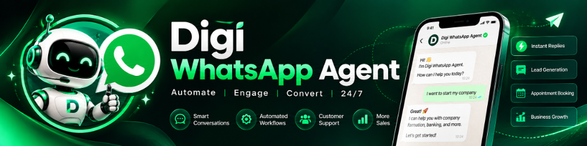
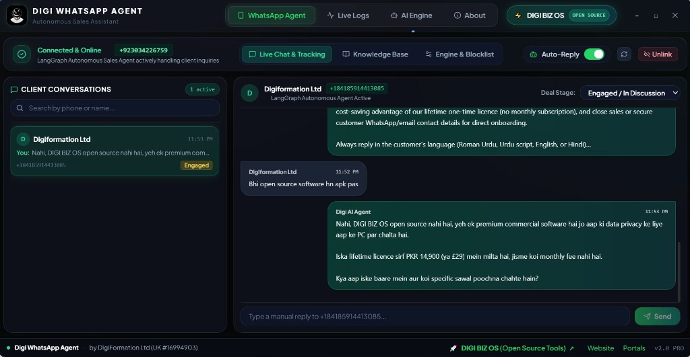
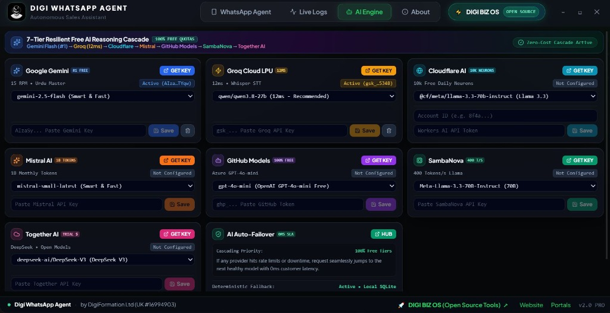
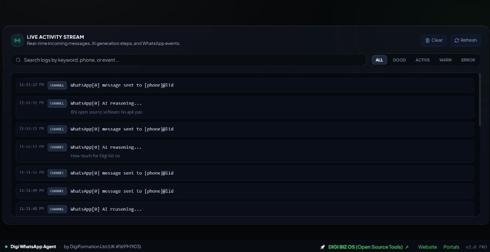

<p align="center">
  
</p>

# 🚀 Digi WhatsApp Agent — 24/7 Autonomous AI Sales Representative

[-0078D6?style=for-the-badge&logo=windows)](https://www.digibizos.co.uk/open-source/digi-whatsapp-agent)
[](https://www.digibizos.co.uk/open-source/digi-whatsapp-agent)
[](https://www.digibizos.co.uk/open-source/digi-whatsapp-agent)
[](LICENSE)
[-blue?style=for-the-badge)](https://www.digiformation.co.uk/)
[](https://www.digibizos.co.uk/pricing)

**Digi WhatsApp Agent** is an autonomous, production-ready AI Sales Agent and Conversational Engine built specifically for modern businesses, e-commerce stores, and digital agencies by **DIGIFORMATION LTD**.

It pairs directly with your WhatsApp phone number via QR code, eliminates expensive per-message Meta Cloud API fees, stores client memory locally in SQLite, and negotiates sales 24/7 in authentic Roman Urdu, Urdu script, English, or Hindi using a 7-Tier resilient free AI reasoning cascade.

---

## 📥 Downloads & Official Releases

All verified production installers are distributed via the official DIGI BIZ OS Open-Source Portal:

### ⚡ 1-Click Official Windows Installer (Recommended)
👉 **[🚀 Download Digi WhatsApp Agent Setup (.exe)](https://www.digibizos.co.uk/open-source/digi-whatsapp-agent)** — Standalone 1-click Windows installer with embedded SQLite database, zero dependencies, and automatic desktop shortcuts.

🌐 **[Explore all Open-Source Tools on DIGI BIZ OS](https://www.digibizos.co.uk/open-source)**

---

## 📸 Real-World Interface & Visual Showcase

### 1. Live Chat & Autonomous Sales Negotiation
Real-time client conversations handled autonomously by the LangGraph AI agent. Tracks deal stages (`Engaged`, `Qualified`, `Order Initiated`), extracts customer details, and protects pricing rules.

<p align="center">
  
</p>

---

### 2. 7-Tier Resilient Free AI Reasoning Cascade
Zero API downtime. Requests seamlessly cascade through free tiers: **Google Gemini 2.5 Flash** (#1 Primary) ➔ **Groq LPU** (12ms) ➔ **Cloudflare Workers AI** ➔ **Mistral AI** ➔ **GitHub Models** ➔ **SambaNova Cloud** ➔ **Together AI**. If all external APIs fail, deterministic local SQLite rules handle the customer with 0ms latency.

<p align="center">
  
</p>

---

### 3. Real-Time Live Activity Stream & Audit Logs
Complete visibility into every incoming WhatsApp message, transcription event, AI reasoning trace, and outbound response with millisecond precision.

<p align="center">
  
</p>

---

## 🛠️ Simple Step-by-Step Installation Guide (Single EXE Setup)

Installing and running Digi WhatsApp Agent takes less than 60 seconds:

### Step 1: Download the 1-Click Installer
Visit the official download portal at **[https://www.digibizos.co.uk/open-source/digi-whatsapp-agent](https://www.digibizos.co.uk/open-source/digi-whatsapp-agent)** and click **Download Windows Setup (.exe)**.

### Step 2: Run the Installer
Double-click `Digi.WhatsApp.Agent.Setup.1.0.0.exe`. The setup wizard will:
* Install the native desktop application into your Windows system.
* Place a launch shortcut on your **Desktop** and in your **Start Menu**.
* Set up the local SQLite database directory automatically.

### Step 3: Launch & Enter Your Free AI Key
1. Open **Digi WhatsApp Agent** from your desktop shortcut.
2. Navigate to the **AI Engine** tab.
3. Paste a free API key for **Google Gemini** (15 RPM free) or **Groq Cloud** (12ms LPU). Convenient "GET KEY" shortcuts are provided right on the cards.

### Step 4: Scan QR Code & Go Live!
1. Under the **WhatsApp Agent** tab, click **Connect**.
2. A secure QR code will appear on screen.
3. On your phone, open WhatsApp ➔ **Settings** ➔ **Linked Devices** ➔ **Link a Device**, and scan the QR code.
4. Toggle **Auto-Reply** to **ON**.

🎉 **Your autonomous sales agent is now live 24/7!** It will automatically greet incoming leads, answer product inquiries, schedule meetings, and close deals without manual intervention.

---

## ⚡ Core Capabilities & Features

* **📱 Direct QR Pairing (Baileys Protocol):** Zero Meta Cloud API fees, zero per-conversation SaaS tolls (saves $100–$300/mo vs WATI / ManyChat).
* **🧠 7-Tier Free AI Cascade:** Google Gemini 2.5 Flash, Groq LPU, Cloudflare AI, Mistral, GitHub Models, SambaNova, Together AI with 0ms automatic failover.
* **🎙️ Voice Note Transcription (Whisper STT):** Inbound WhatsApp voice notes are transcribed via Groq Whisper and answered naturally in customer's language.
* **🌐 Multilingual Fluency:** Authentic Roman Urdu, Urdu script, English, and Hindi.
* **💾 Local SQLite Memory (Zero Cloud Telemetry):** All conversations, customer contact details, and deal history remain 100% private on your own PC (`data/agent_memory.db`).
* **🛡️ Zero Hallucination & Discount Defense:** Enforces strict fixed package prices and polite anti-discount negotiation defense.
* **👨‍💼 Human Handoff & Escalation:** Flags complex or high-priority inquiries for human staff review.

---

## 💻 Developer Setup (Running from Source)

If you prefer building from source rather than using the 1-click Windows installer:

```bash
# 1. Clone the repository
git clone https://github.com/digiformationltd-creator/digi-whatsapp-agent.git
cd digi-whatsapp-agent

# 2. Install dependencies
npm install

# 3. Configure environment
cp .env.example .env
# Enter your free keys in .env or configure them via GUI

# 4. Start in development mode
npm run dev

# 5. Build production executable
npm run dist:win
```

---

## 🏢 DIGI BIZ OS Ecosystem Integration

Digi WhatsApp Agent is an official open-source tool created by **DIGIFORMATION LTD** (UK Registered Company #16994903).

Looking for the complete all-in-one business operating system for Windows featuring:
* 🤖 Integrated 24/7 WhatsApp AI Sales Pipeline
* 🎙️ Voice JARVIS Desktop Control (<200ms latency)
* 💼 DigiOffice Suite (Docs, Sheets, Slides, PDF with Rust calculation engine)
* 📈 Local CRM & Automated Invoicing
* 🎯 Autonomous B2B Lead Hunting Engine

👉 **[Claim Your DIGI BIZ OS 3-Day Free Trial (£29 Lifetime License)](https://www.digibizos.co.uk/pricing)**

Explore all official open-source releases:
* 🌐 **Open-Source Hub**: [https://www.digibizos.co.uk/open-source](https://www.digibizos.co.uk/open-source)
* 📱 **Digi WhatsApp Agent Subpage**: [https://www.digibizos.co.uk/open-source/digi-whatsapp-agent](https://www.digibizos.co.uk/open-source/digi-whatsapp-agent)
* 🎧 **DIGI Labs Audio Workstation**: [https://www.digibizos.co.uk/open-source/digi-labs](https://www.digibizos.co.uk/open-source/digi-labs)
* 💼 **DigiOffice Suite**: [https://www.digibizos.co.uk/open-source/digioffice](https://www.digibizos.co.uk/open-source/digioffice)

---

## 📄 License

Licensed under the MIT License. Copyright © 2026 DIGIFORMATION LTD. All rights reserved.
