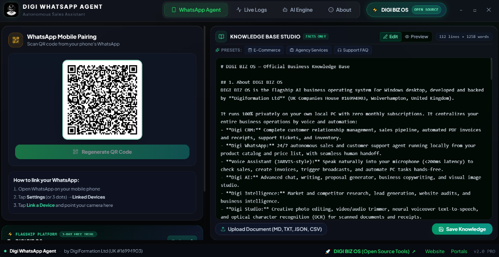

# 🚀 Digi WhatsApp Agent — 24/7 Autonomous AI Sales Representative

[-success?style=for-the-badge&logo=windows)](https://www.digibizos.co.uk/open-source)

[-blue?style=for-the-badge)](https://www.digiformation.co.uk/)

  

> 🌟 **EXPLORE DIGI BIZ OS OPEN SOURCE ECOSYSTEM**  
> Discover our complete open-source suite of sovereign offline AI tools, automated WhatsApp sales agents, local CRM, customer invoicing, document engine, and multi-agent workflows.  
> 👉 **[✨ DIGI BIZ OS Open Source Hub & Tools Portal](https://www.digibizos.co.uk/open-source)**  
> 🌐 **[✨ Digi WhatsApp Agent Official Showcase & Full Docs](https://www.digibizos.co.uk/open-source/digi-whatsapp-agent)**

---

**Digi WhatsApp Agent** is an autonomous, production-ready AI Sales Agent and Conversational Engine built specifically for modern businesses, e-commerce stores, and digital agencies by **DIGIFORMATION LTD** (UK Companies House #16994903).

It pairs directly with your WhatsApp phone number via QR code, eliminates expensive per-message Meta Cloud API fees, stores client memory locally in SQLite, and negotiates sales 24/7 in authentic Roman Urdu, Urdu script, English, or Hindi using a 7-Tier resilient free AI reasoning cascade.

---

## 📥 Downloads & Official Releases

All verified production installers are distributed via the official GitHub Releases and the DIGI BIZ OS Open-Source Portal:

### ⚡ 1-Click Official Windows Installer (Direct Download)
👉 **[🚀 Download Digi WhatsApp Agent Setup (.exe 116MB)](https://www.digibizos.co.uk/open-source)** — Standalone 1-click Windows installer with embedded SQLite database, zero dependencies, and automatic desktop shortcuts.

🌐 **[Official Web Showcase, Live Demos & Specifications on DIGI BIZ OS](https://www.digibizos.co.uk/open-source/digi-whatsapp-agent)**

🌐 **[Explore all Open-Source Tools on DIGI BIZ OS](https://www.digibizos.co.uk/open-source)**

---

## 📸 Real-World Interface & Visual Showcase

### 1. WhatsApp Mobile Pairing & Knowledge Base Studio
Direct QR code pairing powered by the `@whiskeysockets/baileys` WebSocket protocol alongside a real-time Markdown knowledge base editor for instant business facts, catalog prices, and company policies.

  

---

### 2. Live Chat & Autonomous Sales Negotiation
Real-time client conversations handled autonomously by the LangGraph AI agent. Tracks deal stages (`Engaged`, `Qualified`, `Order Initiated`), extracts customer details, and protects pricing rules.

  

---

### 3. 7-Tier Resilient Free AI Reasoning Cascade
Zero API downtime. Requests seamlessly cascade through free tiers: **Google Gemini 2.5 Flash** (#1 Primary) ➔ **Groq LPU** (12ms) ➔ **Cloudflare Workers AI** ➔ **Mistral AI** ➔ **GitHub Models** ➔ **SambaNova Cloud** ➔ **Together AI**. If all external APIs fail, deterministic local SQLite rules handle the customer with 0ms latency.

  

---

### 4. Real-Time Live Activity Stream & Audit Logs
Complete visibility into every incoming WhatsApp message, transcription event, AI reasoning trace, and outbound response with millisecond precision.

  

---

## 🛠️ Sab Se Aasaan Tareeqa (Step-by-Step 1-Minute Setup Guide)

Digi WhatsApp Agent ko chalana intehai aasaan hai — yeh 100% Free hai aur sirf 1 minute mein live ho jata hai!

---

### ⚡ Step 1: 1-Click Installer Download Karein
Official verified single-exe setup direct download karein:  
👉 **[🚀 Download Digi WhatsApp Agent Setup (.exe 116MB)](https://www.digibizos.co.uk/open-source)**  
🌐 **[DIGI BIZ OS Official Showcase & Specs](https://www.digibizos.co.uk/open-source/digi-whatsapp-agent)**

### ⚡ Step 2: Installer Run Karein
Download kiye gaye `Digi.WhatsApp.Agent.Setup.1.0.0.exe` par double click karein.
* Yeh khud-ba-khud aapke PC mein install ho jayega.
* Desktop aur Start Menu par instant launch icon ban jayega.
* Koi extra software ya Node.js install karne ki bilkul zaroorat nahi hai.

### ⚡ Step 3: Dono 100% Free API Keys Lagayein (Hawa Mein Teer Jaisi Superfast Speed! 🚀)
Desktop icon se software open karein aur top menu mein **"AI Engine"** par click karein. Yahan sirf yeh do keys paste karein:

1. **Google Gemini (100% Free API Key)**:
   * **[Google AI Studio se Free Key Lein (1-Click)](https://aistudio.google.com/app/apikey)**
   * Yeh deep reasoning, sales negotiation, aur smart customer conversation ke liye primary brain hai.
2. **Groq Cloud (100% Free Ultra-Fast LPU Key)**:
   * **[Groq Cloud Console se Free Key Lein (1-Click)](https://console.groq.com/keys)**
   * Groq ka hardware LPU sirf **12 milliseconds** mein response process karta hai aur customer ke audio voice notes ko instant text mein convert karta hai.

> 💡 **Yeh Dono Keys Kyun Zaroori Hain?**  
> Dono keys **100% lifetime FREE** hain. Jab aap Gemini aur Groq dono keys enter karte hain, to aapka agent **"hawa mein teer jaisi superfast speed"** pakad leta hai! Inbound message aate hi millisecond mein smart reply generate ho jata hai, aur agar ek service busy ho to doosri foran backup handle kar leti hai (Zero Downtime).

### ⚡ Step 4: WhatsApp QR Code Scan Karein & Go Live!
1. Top bar se **"WhatsApp Agent"** tab par click karein aur **"Connect"** dabayein.
2. Apne mobile WhatsApp se **Linked Devices ➔ Link a Device** kholen aur screen par aane wala QR code scan karein.
3. Connected! Ab aapka AI sales agent 24/7 har customer ko instantly reply kare ga, voice notes sune ga, aur deals close kare ga.

---

## 🌟 Sovereign Desktop Architecture vs Cloud SaaS

| Metric / Feature | DIGI WhatsApp Agent (This App) | Wati / Interakt / Respond.io |
| :--- | :--- | :--- |
| **Monthly Subscription** | **£0 / mo (100% Free)** | $49 – $299 / month |
| **Meta Per-Message Fees** | **£0 (Zero Cloud API Charges)** | $0.03 – $0.08 per template message |
| **Phone Number Pairing** | **1-Click QR Scan (Any Number)** | Strict Meta Business Verification |
| **AI Reasoning Model** | **7-Tier Free Multi-Model Cascade** | Fixed basic bot (charge per credit) |
| **Voice Note Handling** | **Groq Whisper LPU (Roman Urdu / English)** | Not supported or expensive add-on |
| **Data Privacy & Storage** | **100% Local SQLite (`agent_memory.db`)** | Stored on third-party SaaS cloud |
| **Offline Safety** | **Deterministic local rule fallback** | Down when SaaS servers fail |

---

## 🏢 Engineered by DIGIFORMATION LTD

Digi WhatsApp Agent is developed with pride by **DIGIFORMATION LTD** (UK Registered Company #16994903) as part of the sovereign desktop automation tools collection for [DIGI BIZ OS](https://www.digibizos.co.uk/).

* 🌐 **Official Website**: [https://www.digibizos.co.uk/](https://www.digibizos.co.uk/)
* 📦 **Open Source Ecosystem**: [https://www.digibizos.co.uk/open-source](https://www.digibizos.co.uk/open-source)
* 🚀 **Digi WhatsApp Agent Showcase**: [https://www.digibizos.co.uk/open-source/digi-whatsapp-agent](https://www.digibizos.co.uk/open-source/digi-whatsapp-agent)
* 💼 **Company Registration**: UK Companies House #16994903
